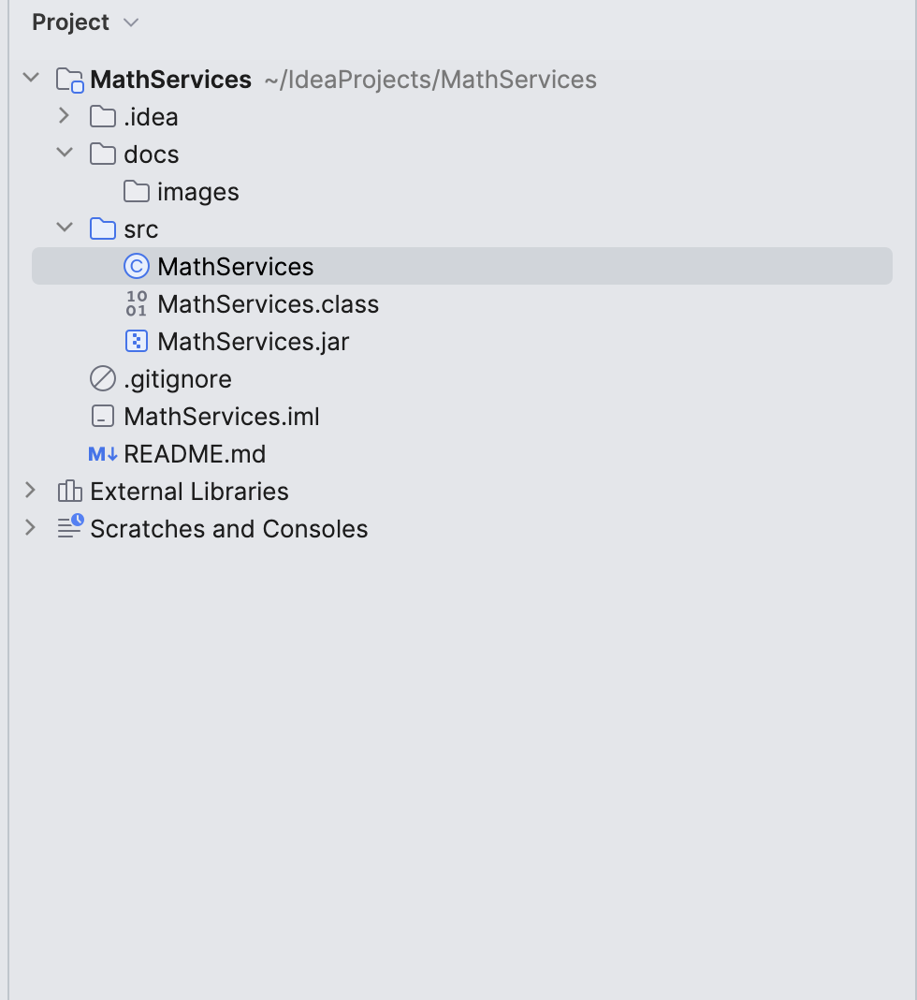
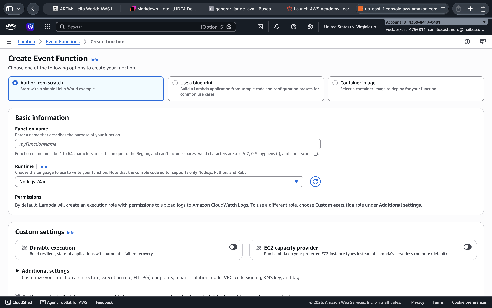
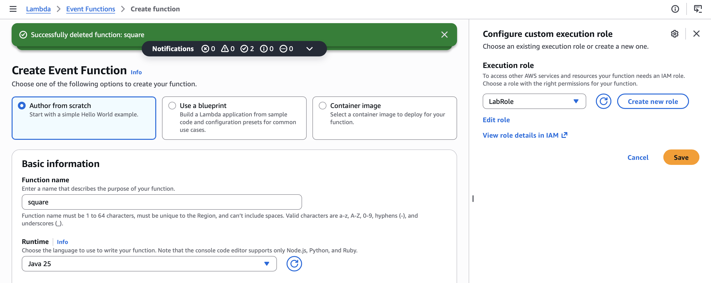
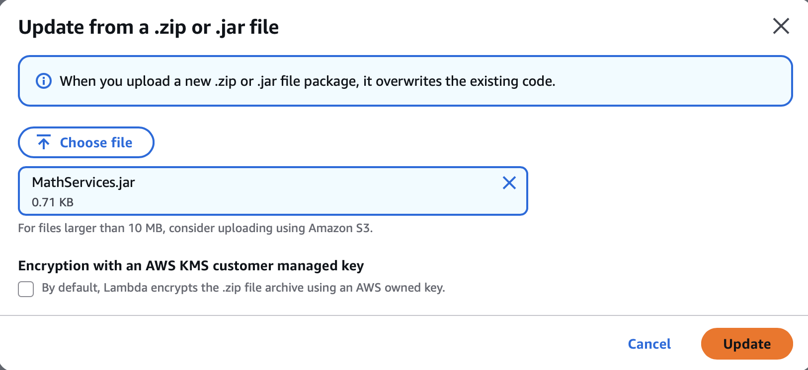
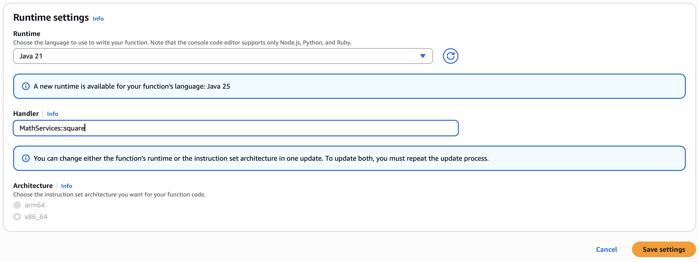
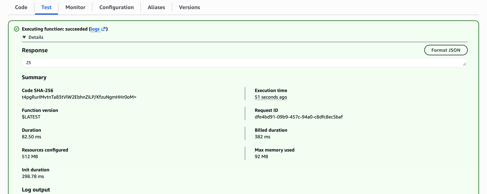
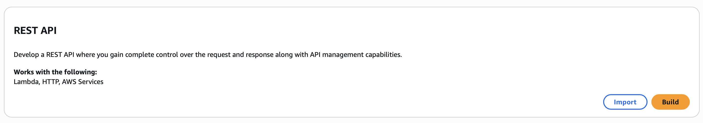

## MathServices
Se crea la clase MathServices
```Java
public class MathServices {
    public static Integer square(Integer i){
        return i*i;
    }
}
```

Compilamos la clase MathServices.java

```bash
javac MathServices.java
```

Creamor el archivo .jar

```bash
jar cvf MathServices.jar MathServices.class
```



Una vez creado nuestro Jar, vamos a AWS academy y lambda para crear la función lambda



Indicamos nombre, runtime y execution role



Cargamos nuestro Jar y le indicamos el nombre de la clase que queremos ejecutar



El formato es [paquete].[servicio]::[metodo]



Hacemos una prueba en **Test**



## Configurar API gateway

Escogemos crear un API REST




Creamos los recursos con el metodo apuntando a la lambda


En el method request agregamos un parametro value


En integration request agregamos un Mapping Template, el cual contruye un mensaje que es entregado a lambda


Hacemos la prueba 

Desplegamos la API


Hacemos la prueba en el navegador


## Security Utils

Creamos una clase SecurityUtils
```Java
public class SecurityUtils {
    public static User login(User u){
        IO.println("Username: " + u.getName());
        IO.println("Password: " + u.getPassword());
        u.setPassword("");
        return u;
    }
}
```

Empaquetamos el proyecto y convertimos a jar

```bash
javac -d out src/*.java
jar cf miapp.jar -C out .
```
Se sube la funcion en lambda como antes


Exponemos el metodo en el API como hicimos antes


## En caso de que quieras hacer pruebas